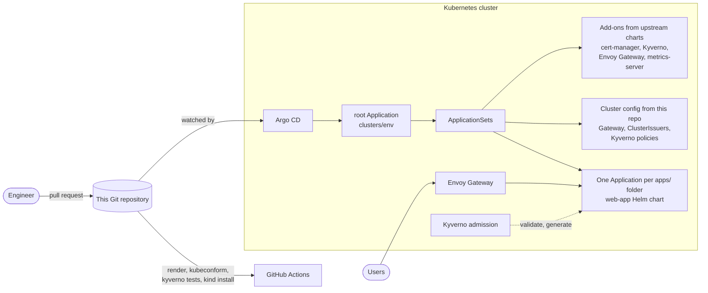

# GitOps platform on Kubernetes with Argo CD

[](https://github.com/muhammad-31/gitops-argocd-platform/actions/workflows/ci.yml)
[](https://github.com/muhammad-31/gitops-argocd-platform/actions/workflows/e2e.yml)


[](LICENSE)

A reference GitOps setup for running services on Kubernetes: Argo CD reconciles
the whole cluster from this repository, from add-ons (cert-manager, Kyverno,
Envoy Gateway, metrics-server) to applications. Policies are written as tested
code and enforced at admission. Every pull request renders and validates
everything before it can merge, and a scheduled job rebuilds the whole platform
on a fresh kind cluster to prove it still converges.

`make up` runs the complete platform on your laptop with kind.

## Architecture



## What is in the box

| Layer | Implementation |
|---|---|
| **GitOps engine** | Argo CD with an app-of-apps root and three ApplicationSets (add-ons, cluster config, apps). Automated sync with prune and self-heal, retries with backoff, server-side apply. |
| **Tenancy** | Two AppProjects: `platform` may install cluster-wide resources; `apps` may only create its own namespace and namespaced objects, and cannot deploy into system namespaces. |
| **Ingress** | Gateway API with Envoy Gateway. Only namespaces labelled `workload-tier=apps` can attach routes. In prod, cert-manager issues Let's Encrypt certificates straight from the Gateway listeners and HTTP redirects to HTTPS. |
| **Policy** | Kyverno 1.19 CEL policies (`ValidatingPolicy`, `GeneratingPolicy`), each with unit tests. **Audit** in dev, **Deny** in prod, from one base via Kustomize. |
| **Pod security** | The built-in Pod Security Admission enforces the *restricted* standard on every app namespace, and a Kyverno policy makes sure that label is never dropped. |
| **Network isolation** | Every app namespace gets a generated default-deny NetworkPolicy; the chart opens only gateway-to-app and DNS. |
| **Workload chart** | [`charts/web-app`](charts/web-app): one chart for stateless HTTP services with secure defaults, PDB, HPA, topology spread, graceful shutdown and a JSON schema for its values. |
| **Quality gates** | yamllint, `helm lint`, kubeconform against Kubernetes 1.35 and CRD schemas, `kyverno test`, rendered apps checked against the prod policies, `ct install` of the chart on kind, plus the full end-to-end run. |

## How changes flow

1. **Add a service:** create `apps/<name>/values.yaml` (+ optional `values-dev.yaml`, `values-prod.yaml`). The `apps` ApplicationSet picks the folder up; no Argo CD changes needed.
2. **Open a pull request:** CI renders every app for every environment and validates it. A manifest the prod cluster would reject fails here, with the policy message.
3. **Merge:** Argo CD syncs the change. Namespaces are created with the `workload-tier=apps` and Pod Security labels, Kyverno adds the default-deny NetworkPolicy, and the route attaches to the shared Gateway.
4. **Drift:** manual `kubectl edit`s are reverted by self-heal. Git stays the source of truth.

## Repository layout

```text
.
├── bootstrap/          # kind config, Argo CD Helm values, root Application per environment
├── clusters/
│   ├── dev/            # AppProjects + ApplicationSets for the dev cluster
│   └── prod/           # same structure, prod values and overlays
├── platform/
│   ├── <add-on>/       # values.yaml (+ values-prod.yaml) for each upstream chart
│   ├── gateway/        # GatewayClass + shared Gateway (prod adds HTTPS)
│   └── cert-manager-issuers/
├── policies/
│   ├── base/           # Kyverno CEL policies (Audit)
│   ├── overlays/       # dev = Audit, prod = Deny
│   └── tests/          # kyverno test cases, good and bad resources per policy
├── charts/web-app/     # reusable application chart
├── apps/podinfo/       # sample service: values per environment
└── hack/               # validate.sh (CI), wait-for-apps.sh, set-repo-url.sh
```

## Quick start on kind

Requirements: Docker, kind, kubectl, Helm 3.14+ or 4.

```bash
make up      # kind cluster -> Argo CD -> root app -> waits until all 8 apps are Healthy
make ui      # Argo CD UI on http://localhost:8443 (prints the admin password)
make demo    # calls podinfo through the Envoy gateway
make down    # delete the cluster
```

Argo CD pulls from GitHub, so the cluster tracks what is pushed to `main`. To try
your own changes, fork the repository and point the manifests at the fork:

```bash
./hack/set-repo-url.sh https://github.com/<you>/gitops-argocd-platform.git
```

## Running it on a real cluster

- Apply `bootstrap/root-prod.yaml` instead of `root-dev.yaml`.
- Replace `podinfo.example.com` and `platform-team@example.com` with your domain and email, and point DNS at the Envoy load balancer.
- Prod runs Kyverno with three admission replicas and policies in **Deny** mode. Check the dev PolicyReports (`kubectl get policyreports -A`) before promoting.

## Policies

| Policy | Checks | dev | prod |
|---|---|---|---|
| `disallow-latest-tag` | every image has an explicit tag or digest, never `:latest` | Audit | Deny |
| `require-requests-limits` | CPU/memory requests and a memory limit on every container | Audit | Deny |
| `require-probes` | readiness and liveness probes on Deployments, StatefulSets, DaemonSets | Audit | Deny |
| `restrict-image-registries` | images come from an allow-list of registries | Audit | Deny |
| `require-pod-security-labels` | app namespaces keep `pod-security.kubernetes.io/enforce=restricted` | Audit | Deny |
| `default-deny-network-policy` | generates a default-deny NetworkPolicy in every app namespace | on | on |

```bash
make test-policies   # 27 test cases: compliant and non-compliant resources per policy
```

## Design decisions

- **Gateway API, not ingress-nginx.** The ingress-nginx project was retired in March 2026. Gateway API is the upstream successor and separates platform-owned Gateways from team-owned routes.
- **Kyverno CEL policies, not `ClusterPolicy`.** `kyverno.io/v1` ClusterPolicy is deprecated in Kyverno 1.19 and removed in 1.20. The CEL policy types are the supported path and run the same expressions as Kubernetes ValidatingAdmissionPolicy.
- **Pod Security Admission for the restricted standard.** It is built into Kubernetes and needs no webhook. Kyverno covers what PSA cannot express (registries, tags, probes, resources) and protects the labels PSA relies on.
- **No CPU limits by default.** CPU limits cause CFS throttling and tail-latency spikes even when the node is idle. Requests give fair scheduling, and memory limits contain leaks.
- **ApplicationSets over hand-written Applications.** Adding a service is a values file, not Argo CD YAML, and every app gets the same sync policy and namespace labels.

## License

[MIT](LICENSE)
